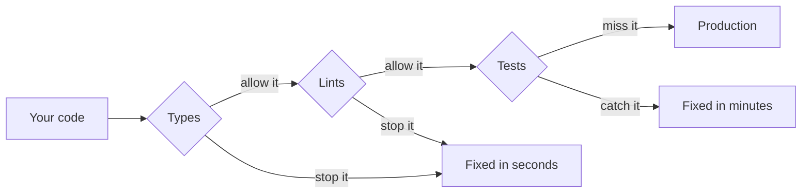

# rustacean-lessons

Lessons in writing Rust services where wrong programs fail the build: typed failures,
explicit dependencies, and cancellation you can see, without a framework.

You can be new to Rust. **[Start here](guide/00-start-here.md)** for a ten-minute primer.
Each chapter then has a guide that explains the idea, and a test file that proves it.

## The idea

You can find a mistake while compiling, while testing, or in production. Each step costs
more than the last, so these lessons move mistakes towards the compiler:



It starts with signatures. A good one answers three questions: what do I get back, how can
this fail, and what does it need?

```rust
async fn signup(args: SignupArgs, deps: &SignupDeps) -> Result<UserId, SignupError>
```

`args` holds the data for this call and `deps` holds the outside world. You, a test or a
coding agent can see what this function does without opening it.

## Chapters

| Chapter | You learn | Guide | Code |
|---|---|---|---|
| 0. Start here | Enough Rust to begin | [Guide](guide/00-start-here.md) | |
| 1. Errors | Return failures as values, and map them to responses | [Guide](guide/01-errors.md) | [Code](src/ch01_errors.rs) |
| 2. Services | Pass dependencies in, and swap them in tests | [Guide](guide/02-services.md) | [Code](src/ch02_services.rs) |
| 3. Resources | Share with `Arc`, clean up with `Drop` | [Guide](guide/03-resources.md) | [Code](src/ch03_resources.rs) |
| 4. Illegal states | Make bad values impossible to build | [Guide](guide/04-illegal-states.md) | [Code](src/ch04_illegal_states.rs) |
| 5. Async | Treat each `.await` as an exit, and make retries safe | [Guide](guide/05-async.md) | [Code](src/ch05_async.rs) |
| 6. Guard rails | Turn rules into build failures | [Guide](guide/06-guard-rails.md) | [Code](src/ch06_guard_rails.rs) |
| 7. Payment | Combine all of it in one workflow | [Guide](guide/07-payment.md) | [Code](src/ch07_payment.rs) |

## Run it

```bash
make check                     # format, lints, lessons, compile-fail tests
cargo test ch02                # one chapter
cargo test ch02 -- --ignored   # that chapter's exercise
```

You need Rust 1.97.1 and edition 2024, and `rustup` installs them on your first `cargo`
command here. The repo pins that version because the saved compiler errors change between
releases. To move up, run `TRYBUILD=overwrite cargo test --test compile_fail` and read the
diff.

## What you get, and what it costs

The compile errors below are real programs in `tests/compile_fail/`, each with its
compiler output saved beside it.

The comparison uses TypeScript as one example of a language without ownership. If
you don't know it, read that column as "most languages".

**Mistakes Rust stops**

| Mistake | Rust | Without ownership |
|---|---|---|
| Use a connection after closing it | [E0382](tests/compile_fail/ch03_use_after_close.stderr) | Type-checks, fails at runtime |
| Charge the same payment twice | [E0382](tests/compile_fail/ch04_double_charge.stderr) | Type-checks, charges twice |
| Forge a validated value | [E0603](tests/compile_fail/ch04_forged_amount.stderr) | `0 as Amount` type-checks |
| Forget to handle a new error | [E0004](tests/compile_fail/ch01_new_variant_not_handled.stderr) | Thrown errors aren't in the type |
| Write shared state from two threads | [E0499](tests/compile_fail/ch04_data_race.stderr) | No threads sharing memory, so no parallelism |
| Hold a lock across `.await` in a task | [Rejected](tests/compile_fail/ch05_lock_across_await.stderr) | Not applicable |

**Stopped in either language**

| Mistake | Rust | Without ownership |
|---|---|---|
| Charge an unvalidated payment | [E0599](tests/compile_fail/ch04_charge_unvalidated.stderr) | Compile error, with a type per stage |
| Call something without a dependency | [E0063](tests/compile_fail/ch02_missing_dependency.stderr) | Compile error, with a required parameter |

**What it costs you**

| Problem | What you have to do |
|---|---|
| Async cleanup is skipped on cancellation ([guide](guide/03-resources.md#the-cost-drop-cant-wait), [code](src/ch03_resources.rs)) | Use a guard whose `Drop` spawns the cleanup ([guide](guide/07-payment.md#a-lock-that-survives-cancellation), [code](src/ch07_payment.rs)) |
| A charge with no record frees its key ([guide](guide/07-payment.md#the-gap-the-lock-doesnt-cover), [code](src/ch07_payment.rs)) | Rely on the provider honouring the reference, or hold the key until reconciled |
| Any `.await` can be the last line that runs ([guide](guide/05-async.md#the-rule-every-await-is-an-exit), [code](src/ch05_async.rs)) | Use transactions, or spawn the critical part |
| Enums are nominal, so handling one error can't narrow the type ([guide](guide/01-errors.md#the-cost), [code](src/ch01_errors.rs)) | Write the second enum |
| Error unions and dependencies aren't inferred | Write them yourself. The compiler checks them |
| Race conditions still compile ([guide](guide/04-illegal-states.md#the-cost-race-conditions-still-compile), [code](src/ch04_illegal_states.rs)) | Read and write under one lock |
| Some silent drops pass every lint ([guide](guide/06-guard-rails.md#the-cost-three-silent-drops-get-through), [code](src/ch06_guard_rails.rs)) | `_ = x`, `x.ok();` and `drop(x)` need review |

## The story report

Chapter 7's tests are executable stories, so each run also writes
`.executable-stories/raw-run.json`. To turn that into a readable report:

```bash
npx -p executable-stories-formatters executable-stories format --format html
```

## Working here

[AGENTS.md](AGENTS.md) has the rules. The lints apply to lesson code too, so the
lessons follow what they teach.
