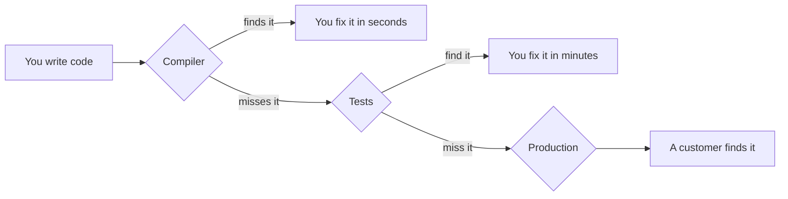
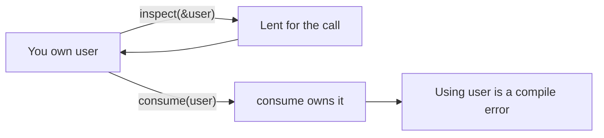
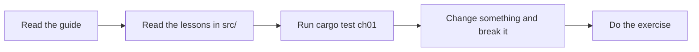
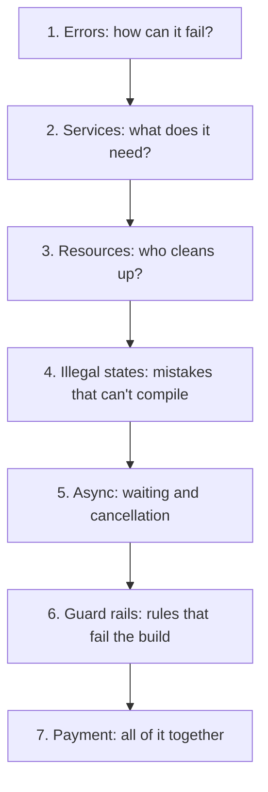

# Start here

You can write code in some language, and you've heard Rust is hard. These lessons
teach you to use the Rust compiler as a colleague who reads every line before it
runs. Start with this page. It gives you enough Rust to read chapter 1.

## The problem these lessons solve

You can find a mistake at three moments:



Each step to the right costs more. A compile error costs you a few seconds. A
customer charged twice costs you money and trust.

So you want mistakes caught as far left as possible. In Rust you do that by
describing your program in types, the labels that say what kind of thing a value
is. Once a mistake breaks the rules of a type, the compiler refuses to build the
program. These lessons call that "failing the build".

Coding agents gain the same benefit. An agent that makes a mistake gets a precise
error message and fixes it on the next try.

## Set up

Install Rust with [rustup](https://rustup.rs), then run the full check:

```bash
make check
```

The first run downloads the Rust version this repo pins and takes a few minutes.
Green output means every lesson passed.

## Ten minutes of Rust

Read this section once. Come back to it while you work through the chapters.

### Variables

```rust
let name = "Alice";      // can't change
let mut count = 0;       // `mut` lets it change
count += 1;
```

Variables stay fixed unless you write `mut`. You can see at a glance which values
change.

### Functions

```rust
fn add(a: u32, b: u32) -> u32 {
    a + b
}
```

`u32` means an unsigned 32-bit integer, so a whole number that can't go below zero.
The last line has no semicolon, which makes it the return value.

### Structs group data

```rust
struct User {
    id: u32,
    name: String,
}

let user = User { id: 1, name: "Alice".to_string() };
```

`String` is text you own and can change. `&str` is a view of text that someone else
owns, and `"Alice"` is one of those. That's why you'll see `.to_string()` so often.

### Enums list the possibilities

```rust
enum Payment {
    Card { number: String },
    Invoice,
}
```

A value of this type is one of these variants and no other, and a variant can carry data.
Enums drive most of these lessons.

### `match` handles each possibility

```rust
match payment {
    Payment::Card { number } => println!("card {number}"),
    Payment::Invoice => println!("invoice"),
}
```

If you leave a variant out, the program won't compile.

### `impl` adds methods

```rust
impl User {
    fn greeting(&self) -> String {
        format!("Hello {}", self.name)
    }
}
```

`&self` means the method borrows the value it's called on. `format!` builds a string.
A name ending in `!` is a macro, which is code that writes code at compile time.

### Traits describe behaviour

A trait lists methods a type must provide. It works like an interface in other
languages.

```rust
trait Greet {
    fn greet(&self) -> String;
}

impl Greet for User {
    fn greet(&self) -> String {
        format!("Hi {}", self.name)
    }
}
```

### Ownership

Ownership is the idea that makes Rust different. Each value has one owner. If you
pass a value to a function, you hand it over and you can't use it afterwards. If you
want to keep it, you lend it with `&`.

```rust
fn consume(user: User) {}    // takes the value
fn inspect(user: &User) {}   // borrows it

let user = make_user();
inspect(&user);  // lent, and you get it back
inspect(&user);  // fine
consume(user);   // handed over
inspect(&user);  // compile error: you gave it away
```



Rust frees a value's memory as soon as its owner goes away, so Rust needs no garbage
collector. Chapters 3 and 4 use this same rule to prevent bugs that have nothing to
do with memory.

### `Option` and `Result`

Rust has no `null` and no exceptions. It has two enums from the standard library:

```rust
enum Option<T> { Some(T), None }        // a value, or nothing
enum Result<T, E> { Ok(T), Err(E) }     // a success, or a failure
```

`T` and `E` are placeholders, called generics. `Option<String>` is "maybe a String".

### Attributes and tests

Lines starting `#[...]` give the compiler instructions. Two appear everywhere here:

```rust
#[derive(Debug, PartialEq)]   // generate printing and == for this type
struct Point { x: u32 }

#[test]                        // run this function under `cargo test`
fn points_compare() {
    assert_eq!(Point { x: 1 }, Point { x: 1 });
}
```

## How to work through a chapter



1. Read the guide page. It explains the idea and why it exists.
2. Open the matching file in `src/` and read it top to bottom. Each test is a claim.
3. At a PREDICT box, guess the answer before you read on.
4. Break something on purpose and read the compiler's message.
5. Do the exercise with `cargo test ch01 -- --ignored`, then remove its `#[ignore]`
   line once you've written your test.

## Chapters



Go to [chapter 1](01-errors.md).

## Glossary

| Word | Meaning |
|---|---|
| Borrow | Lend a value with `&` without giving it up |
| Compile error | The compiler refuses to build your program |
| Crate | A Rust package. `tokio` and `thiserror` are crates |
| Dependency | Something your code needs from outside, like a database |
| Fake, stub, spy | Stand-ins for a real dependency in a test (chapter 2) |
| Future | Work that will finish later. It starts once you `.await` it (chapter 5) |
| Idempotent | Safe to do twice: the second time changes nothing |
| Lint | An extra rule checked by Clippy, Rust's linter (chapter 6) |
| Move | Hand a value to a new owner |
| Panic | Rust's crash for bugs. It stops the current thread |
| Trait | A named set of methods a type can provide |
| Variant | One of the options in an enum |
