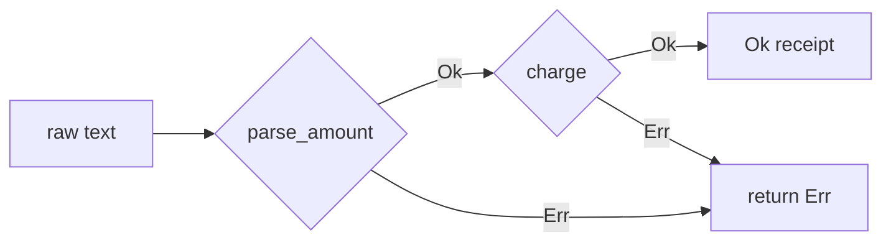
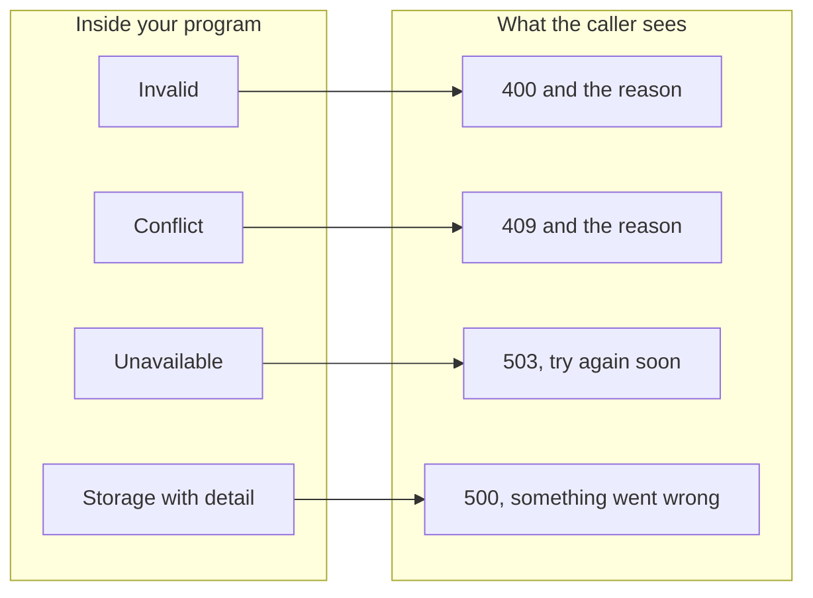

# Chapter 1: Errors

Code: [src/ch01_errors.rs](../src/ch01_errors.rs). Run it with `cargo test ch01`.

## The problem

Look at this signature from a language with exceptions:

```typescript
function pay(raw: string): Receipt
```

It promises a receipt. Yet the amount might be invalid, or the provider might
decline, and the signature hides both. You find out by reading the code, or by
watching it crash in production.

A good signature answers three questions:

1. What do I get back?
2. How can this fail?
3. What does it need?

This chapter covers the first two.

## The idea: a failure is a value

Rust functions return failures the same way they return successes:

```rust
fn pay(raw: &str) -> Result<String, PayError>
```

Read that as "you get a `String`, or you get a `PayError`". The caller holds a
`Result` and must open it to reach the `String`. You can't reach the success without
thinking about the failure, so you can't forget it.

## `?` keeps the code readable

Checking a `Result` after each step would bury your logic. The `?` operator does the
check for you. On `Ok` it hands you the value. On `Err` it returns from the function
with that error.

```rust
fn pay(raw: &str) -> Result<String, PayError> {
    let amount = parse_amount(raw)?;
    let receipt = charge(amount)?;
    Ok(receipt)
}
```

You read the happy path from top to bottom. Each `?` marks a place you can leave it:



The two steps fail in different ways, so `PayError` is an enum with a variant for
each. The `#[from]` attribute generates the conversion that `?` needs.

## `match` forces a decision

To recover from a failure, you `match` on it:

```rust
let name = match find_name(id) {
    Ok(name) => name,
    Err(UserNotFound) => "guest".to_string(),
};
```

The compiler checks that you covered every variant. That check pays off later. Add a
`Frozen` variant to an error enum, and each `match` that doesn't handle it stops
compiling. The compiler hands you a to-do list of the places to update, and you or
an agent can work down it.

The list disappears if you write `_ =>`, which matches anything, including variants
added next year. This repo bans `_` on enums for that reason.

## Errors and bugs are different things

| | Expected failure | Bug |
|---|---|---|
| Example | The card was declined | You divided by a zero you promised to check |
| Who can fix it | The caller, at runtime | You, by changing the code |
| In Rust | `Err`, named in the signature | `panic!`, which stops the thread |

A declined card is normal business. Your code must handle it. A panic means your code
broke its own promise, and no caller can do anything sensible about that.

Beginners reach for `.unwrap()` because it opens a `Result` in one call. It also turns
a failure into a crash, so an expected failure becomes a bug. This repo's build
rejects `.unwrap()`, and lesson 6 proves it.

## Failures meet the outside world at the boundary

Inside your program, a failure is a typed value. A web client needs a status code and
a safe message. Translate between them in one place:



The function is one exhaustive `match`, which gives you two guarantees. A new variant
can't compile until you choose its response. And the `Storage` variant keeps database
details out of the response, so a connection string can't leak to a customer.

## The cost

Two things take more typing than you might like.

You write the union of errors yourself. Some languages work out "this can fail with A
or B" from the code. In Rust you declare the enum, and the compiler checks it.

Handling one error doesn't shrink the type. Say `load` can fail with `NotFound`,
`Timeout` or `Corrupt`, and you handle `NotFound`. A Rust enum can't lose a variant,
so to say "now only two remain" you write a second enum. Lesson 5 shows that.

## Lessons

| Lesson | The claim | Test |
|---|---|---|
| 1 | Failures are values you can compare | `lesson_1_failures_are_values_you_can_compare` |
| 2 | `?` converts each error into the union | `lesson_2_question_mark_converts_each_error_into_the_union` |
| 3 | Handling the last error removes `Result` | `lesson_3_handling_the_only_error_removes_result_from_the_type` |
| 4 | A new variant breaks matches that miss it | `lesson_4_a_new_variant_breaks_every_match_that_misses_it` |
| 5 | Narrowing takes a second enum | `lesson_5_narrowing_an_error_takes_a_second_enum` |
| 6 | The build rejects `.unwrap()` | `lesson_6_the_build_rejects_unwrap` |
| 7 | Each failure gets its own response | `lesson_7_each_kind_of_failure_gets_its_own_response` |

Next: [chapter 2, services](02-services.md).
