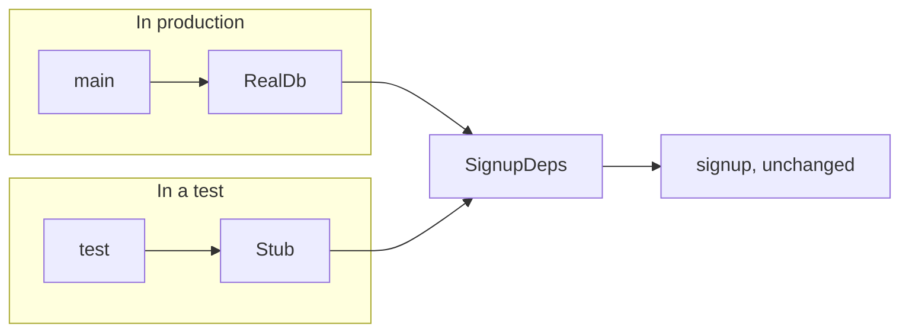
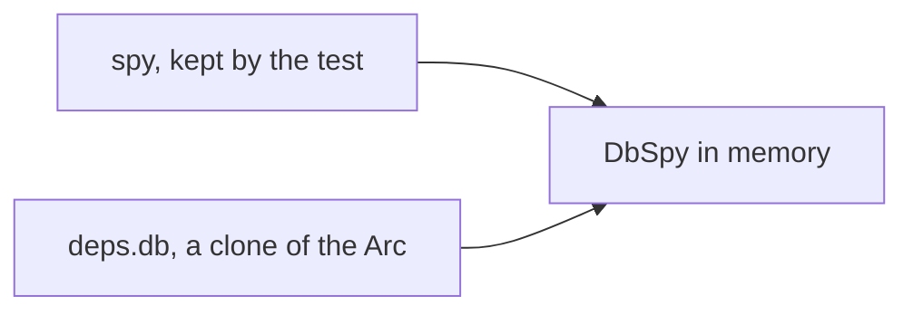

# Chapter 2: Services

Code: [src/ch02_services.rs](../src/ch02_services.rs). Run it with `cargo test ch02`.

## The problem

Your code needs the outside world: a database, a clock, a payment provider. Suppose
a function opens its own database connection:

```rust
async fn signup(name: String) {
    let db = connect_to_production().await;
    db.save(name).await;
}
```

You've now got two problems. The signature says the function needs a name, and it
hides the database. And your test needs a real database, so it takes seconds, breaks
when the network does, and struggles to simulate a failure.

## The idea: pass what you need

Make the need an argument. Everything from the outside world arrives in one struct:

```rust
async fn signup(args: SignupArgs, deps: &SignupDeps) -> Result<UserId, SignupError>
```

`args` holds the data for this call. `deps` holds the outside world. This signature
answers all three questions: you get a `UserId`, you might get a `SignupError`, and
the function needs a `SignupDeps`. The name for this is dependency injection, and it
needs no framework.



The function stays the same in both worlds. You change what you hand it.

## Traits make the swap possible

A trait states what a service can do, with no implementation:

```rust
#[async_trait]
trait Db: Send + Sync {
    async fn get_name(&self, id: u32) -> String;
}
```

Any struct can implement it, and `deps` holds one of them:

```rust
struct GreetDeps {
    db: Arc<dyn Db>,
}
```

That field type packs in three ideas:

| Piece | Meaning | Why you need it |
|---|---|---|
| `dyn Db` | Some type that implements `Db`, chosen at runtime | Production and tests supply different types |
| `Arc<...>` | A shared pointer with a count of its owners | Several parts of your program can hold the same service |
| `Send + Sync` | Safe to use across threads | Async tasks can move between threads |

`#[async_trait]` is a small crate that makes `async fn` work with `dyn`. Rust's built-in
async traits reject `dyn` with error E0038.

## Stand-ins for tests

Each of these is a struct you write by hand. Rust needs no mock library.

| Stand-in | Behaviour | Use it to test |
|---|---|---|
| Stub | Returns a fixed answer | Your code's logic, given a known input |
| Failing stub | Returns an error | The sad path, with no broken database needed |
| Spy | Records its calls | How your code used the service |
| Fake | A working in-memory version | Flows that write and then read |

A spy needs one more step. The test wants to inspect it after the code runs, and the
code needs to hold it too. `Arc` lets both hold it:



`spy.clone()` copies the pointer and leaves the data alone, so both names point at
the same spy.

## One small deps struct per function

You might want one big `AppDeps` struct and pass it everywhere. Resist that. If
every function takes everything, signatures stop telling you what each function
needs. A small `SignupDeps` with two fields keeps the signature honest.

This repo uses traits for I/O edges only: the database, the provider, the clock.
Business logic stays as plain functions. A trait with one implementation adds a layer
and buys you nothing.

## You can't forget a dependency

Build a struct and leave a field out, and the program won't compile (error E0063). A
DI container wires things at runtime, so it can start up and crash on first use. Here
a `Greeter` without a `Db` can't exist.

## Three spellings of the same need

Lesson 9 shows the other styles so you recognise them in other people's code:

```rust
async fn greet(id: u32, deps: &GreetDeps) -> String      // this repo
async fn greet(id: u32, db: &impl Db) -> String          // generic
async fn greet(id: u32, context: &impl HasDb) -> String  // accessor trait
```

The compiler checks all three. The first keeps signatures short at the small cost of
one crate. The generic style spreads a type parameter into every caller. The accessor
style needs a trait per service.

## The cost

Nothing infers your dependencies. Some type systems work out what a function needs by
reading what it calls. In Rust, a function that starts using a mailer needs a new
field, and each caller must supply it. You type more, and the compiler confirms you
got it right.

Nothing stops a function reaching for a dependency on its own, either. Chapter 6 bans the
common ones, like reading the clock.

## Lessons

| Lesson | The claim | Test |
|---|---|---|
| 1 | The caller supplies what a function needs | `lesson_1_the_caller_hands_over_what_the_function_needs` |
| 2 | Swap the implementation and keep the code | `lesson_2_swap_the_implementation_not_the_code` |
| 3 | Async needs no change, and no real waiting | `lesson_3_async_needs_no_change_and_no_real_waiting` |
| 4 | A spy records how you used a service | `lesson_4_a_spy_records_how_the_service_was_used` |
| 5 | A missing dependency can't compile | `lesson_5_a_greeter_without_a_db_does_not_compile` |
| 6 | Stubs drive both paths | `lesson_6_stubs_drive_both_paths` |
| 7 | Each test starts empty | `lesson_7_the_next_test_starts_empty` |
| 8 | Several dependencies are several fields | `lesson_8_in_memory_store_and_spy_logger` |
| 9 | Three ways to state a need | `lesson_9_three_spellings_of_the_same_requirement` |

Next: [chapter 3, resources](03-resources.md).
