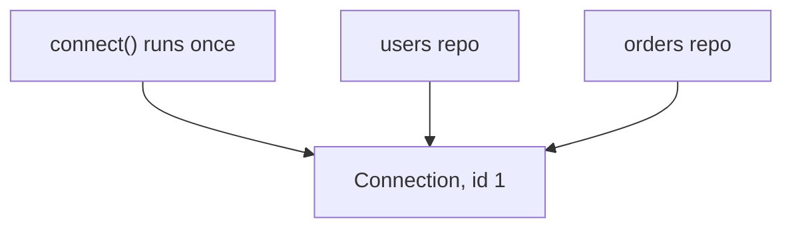
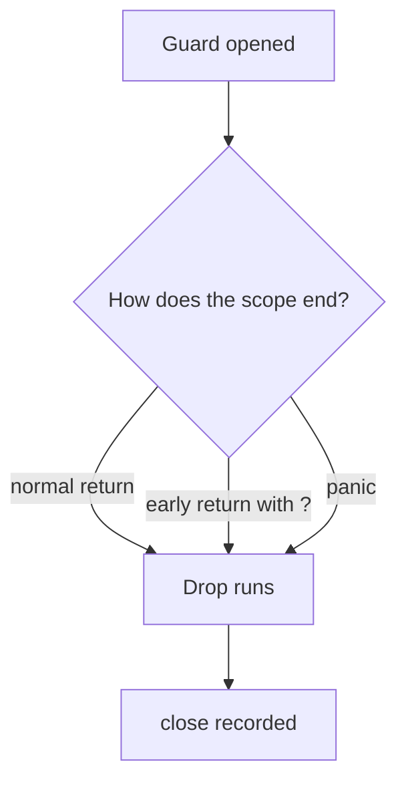
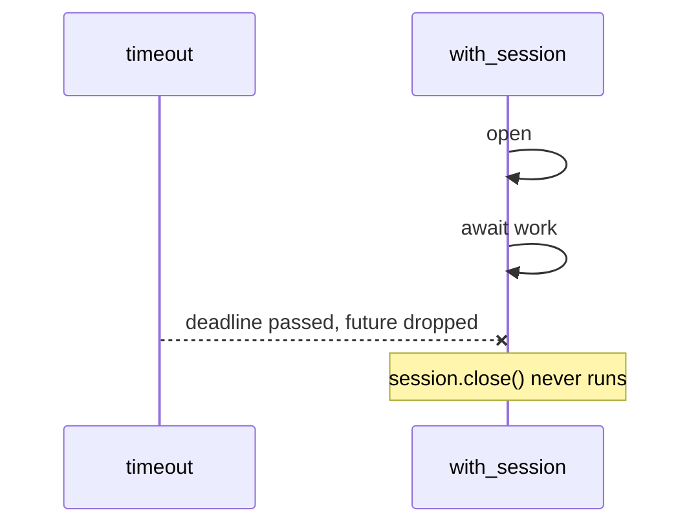

# Chapter 3: Resources

Code: [src/ch03_resources.rs](../src/ch03_resources.rs). Run it with `cargo test ch03`.

## The problem

Connections, files and locks need three things: you open them, you share them, and
you close them. Mistakes at each stage cause real outages:

- You open two connection pools by accident and exhaust the database.
- You forget to close a file on the error path, and it leaks.
- You use a connection after closing it, and it crashes at runtime.

## Build your app in one place

Frameworks can wire your app for you. In Rust you write that code yourself, in a
function called from `main`. People call this the composition root.

```rust
async fn build_app(url: &str) -> Result<App, ConnectError> {
    let connection = Arc::new(connect(url).await?);
    Ok(App {
        users: Repo { connection: connection.clone() },
        orders: Repo { connection },
    })
}
```

You read it top to bottom, in the order it runs. A failure uses `?`, as anywhere else.

## Sharing shows up in the code

`Arc` stands for atomic reference count. It keeps a count of how many owners a
value has, and frees the value once the count reaches zero. `.clone()` adds an owner.



One `connect` call means one connection. Two calls mean two. You can answer "are these
sharing?" by reading the code, with no framework rules to remember.

## `Drop` runs your cleanup

Rust runs a value's `Drop` code when its owner goes away. You don't call it. So cleanup
happens on each way out of a function:



Other languages give you `try/finally` or `defer`, and you must remember to write them.
Here the type carries the cleanup, so you can't forget. Values drop in reverse order,
so a session closes before the pool it came from.

The name for this pattern is RAII, and you'll see it across Rust. A `MutexGuard`
unlocks in its `Drop`. A file closes in its `Drop`.

## The cost: `Drop` can't wait

`drop` is an ordinary function, so it can't use `.await`. Say your connection needs to
send a goodbye message over the network. You have to write an async `close()`, and
someone has to call it.

A helper covers the normal paths:

```rust
async fn with_session<T, E>(events: &Events, work: impl AsyncFnOnce(&Session) -> Result<T, E>) -> Result<T, E> {
    let session = Session::open(events).await;
    let outcome = work(&session).await;
    session.close().await;
    outcome
}
```

Now cancel it. In Rust, cancelling async work means dropping it. The code stops at the
`.await` it had reached, and the lines below never run:



Lesson 5 proves this with a test. Chapter 5 explains cancellation, and chapter 7 shows
the fix: a guard whose `Drop` starts the async cleanup as a separate task.

## Closed things stay closed

`close` takes `self` by value:

```rust
async fn close(self) { ... }
```

Calling it hands the session over, so the session is gone. Using it afterwards is a
compile error (E0382, "borrow of moved value"). You've turned a runtime crash into a
build failure with one word in a signature.

Most languages can't do this. A closed handle remains an ordinary object, so the call
compiles and fails in production.

There's a limit. Inside an `Arc` you share the value, so you can't hand it over.
`Arc::try_unwrap` gives it back once a single owner remains, and lesson 6 shows that.

## Lessons

| Lesson | The claim | Test |
|---|---|---|
| 2 | One constructor call is one connection | `lesson_2_one_constructor_call_is_one_connection` |
| 3 | Two calls are two connections | `lesson_3_two_constructor_calls_are_two_connections` |
| 3 | A failed build returns an error | `lesson_3_a_failed_build_returns_an_error_not_an_app` |
| 4 | `Drop` runs on early return | `lesson_4_drop_runs_on_early_return` |
| 4 | `Drop` runs on panic | `lesson_4_drop_runs_on_panic` |
| 4 | Resources close in reverse order | `lesson_4_resources_close_in_reverse_order` |
| 5 | Cancellation skips async cleanup | `lesson_5_cancellation_skips_async_cleanup` |
| 6 | Using a closed session can't compile | `lesson_6_using_a_closed_session_does_not_compile` |

Next: [chapter 4, illegal states](04-illegal-states.md).
