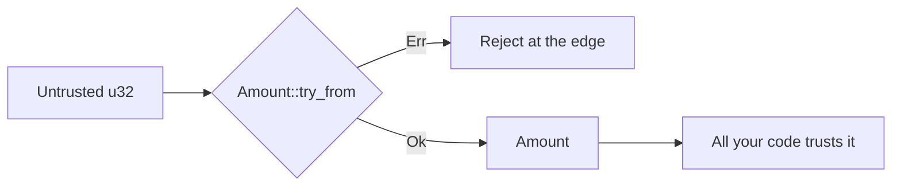
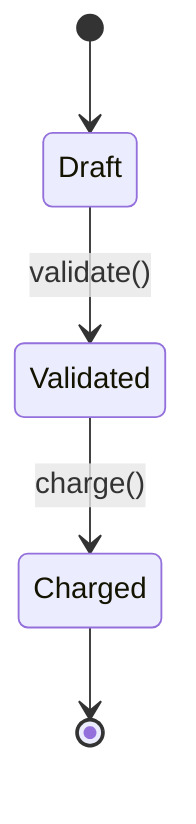
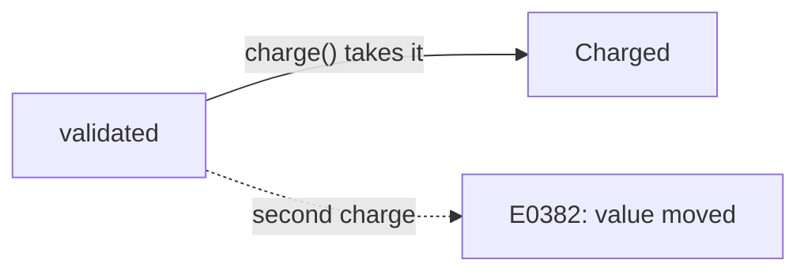
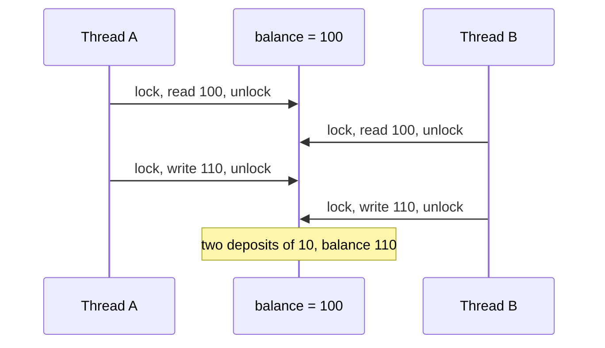

# Chapter 4: Illegal states

Code: [src/ch04_illegal_states.rs](../src/ch04_illegal_states.rs). Run it with
`cargo test ch04`.

## The problem

Validation bugs follow a pattern. One function checks an amount is positive. Another
function trusts that someone called the first one. Six months later a new caller
skips the check, and you charge a customer zero pounds.

You can add more checks. A better answer is to design the types so that a bad value
can't exist. People call this "making illegal states unrepresentable". The compiler
then does the checking across all your code.

## Parse once, then trust the type

Give the checked value its own type, and keep its field private:

```rust
mod money {
    pub struct Amount(u32);   // the field has no `pub`

    impl TryFrom<u32> for Amount {
        type Error = NotPositive;

        fn try_from(minor_units: u32) -> Result<Self, NotPositive> {
            if minor_units == 0 {
                return Err(NotPositive);
            }
            Ok(Amount(minor_units))
        }
    }
}
```

Code outside `money` can't write `Amount(0)`. The compiler rejects it with E0603, so
`try_from` is the one way in. A function that takes an `Amount` can skip validation,
because the type proves someone ran it.



A wrapper struct like this is called a newtype. It costs nothing at runtime.

## Give each stage its own type

A payment moves through stages. You could use one struct with a `status` field, then
check the status in each function. Instead, make each stage a separate type:



`Draft` has no `charge` method, so charging an unvalidated payment is a compile error.
This pattern is called typestate. Any language with a type per stage can do this much.

## Ownership gives you use-once

Here Rust goes further. Look at the signature:

```rust
impl Validated {
    fn charge(self) -> Charged { ... }
}
```

`self` has no `&`, so `charge` takes ownership. Call it, and you've handed over your
`Validated`. A second call uses a value you no longer have:

```rust
let validated = draft.validate()?;
let first = validated.charge();
let second = validated.charge();   // error[E0382]: use of moved value
```



Most type systems can say "this is validated". Without ownership, they can't say
"you can use this once", so a double charge compiles.

Know the limit. This stops double use of one value in one process. Two HTTP requests
for the same payment create two values, and the compiler can't connect them. You
still need idempotency keys, which chapter 5 covers.

## Data races

A data race happens when two threads touch the same memory at once and at least one
writes. The result depends on timing, so you can run the code a thousand times and see the bug once.

Rust's rule: you can have many readers or one writer, and not both. The compiler
enforces that across threads:

```rust
thread::scope(|scope| {
    scope.spawn(|| count += 1);
    scope.spawn(|| count += 1);   // error[E0499]: two mutable borrows
});
```

To share state you must say how. An `AtomicU32` or a `Mutex` both work, and the code
then compiles. JavaScript has no data races either, because your code runs on one
thread. Rust gives you the same safety with threads running at once on separate cores.

## The cost: race conditions still compile

A data race and a race condition differ. Rust stops the first. The second is a logic
bug, and the compiler can't see your intent:



Each lock works. The bug sits in the gap between them. Do the read and the write under
one lock to fix it. Lesson 5 runs this exact sequence, and it's your exercise to fix.

## Lessons

| Lesson | The claim | Test |
|---|---|---|
| 1 | Parsing is the only way in | `lesson_1_parsing_is_the_only_way_in` |
| 1 | An amount can't be forged | `lesson_1_an_amount_cannot_be_forged` |
| 2 | The stages run in order | `lesson_2_the_stages_run_in_order` |
| 2 | Charging a draft can't compile | `lesson_2_charging_an_unvalidated_payment_does_not_compile` |
| 3 | Charging twice can't compile | `lesson_3_charging_twice_does_not_compile` |
| 4 | Shared state must say how it's shared | `lesson_4_shared_state_across_threads_must_say_how_it_is_shared` |
| 4 | A data race can't compile | `lesson_4_a_data_race_does_not_compile` |
| 5 | A race condition still compiles | `lesson_5_a_race_condition_still_compiles` |

Next: [chapter 5, async](05-async.md).
