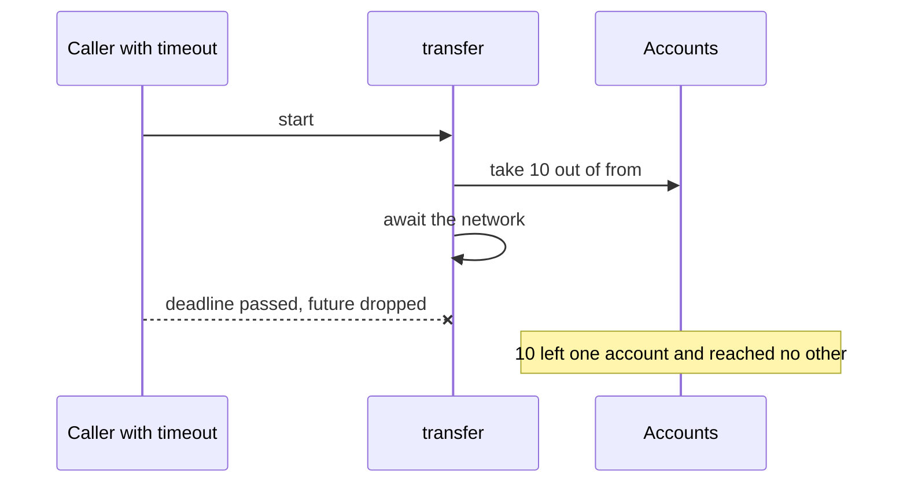
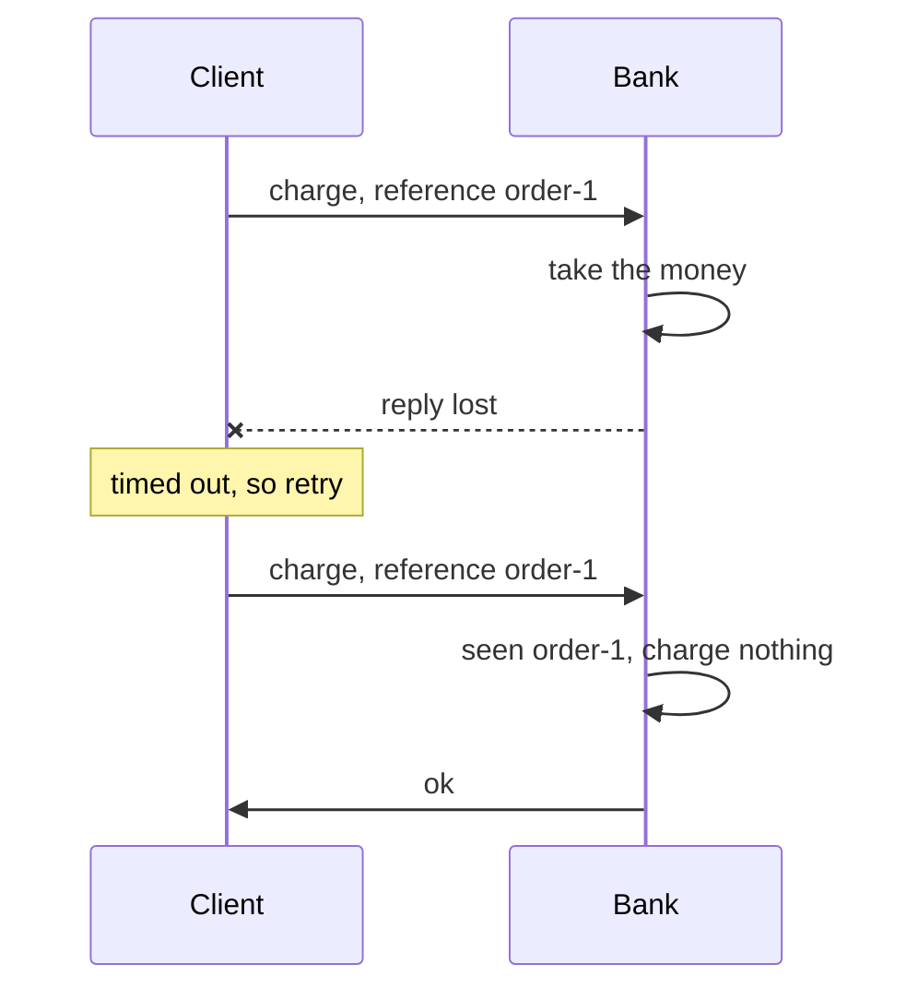

# Chapter 5: Async

Code: [src/ch05_async.rs](../src/ch05_async.rs). Run it with `cargo test ch05`.

## The problem

A web server spends most of its time waiting: for the database, for a provider, for
the network. A thread per request wastes memory while it waits. Async code lets one
thread run thousands of tasks by switching to another task during each wait.

Waiting brings new failure modes. A call can hang, take minutes, or stop halfway.
This chapter gives you the tools, then the rule that keeps you safe.

## A future is work you haven't started

An `async fn` hands you a future, and a future does nothing until you `.await` it.

```rust
let future = record_call(&calls);  // nothing has run
future.await;                       // now it runs
```

JavaScript promises start at once, so this surprises people. A forgotten `.await` means
your save never happens, which is why this repo's build rejects one.

Async Rust needs a runtime to drive futures. These lessons use `tokio`, the most common
choice.

## A timeout is a failure like any other

`tokio::time::timeout` wraps a future and gives you a `Result`. Your error handling from
chapter 1 carries over.

Tests that wait are slow, and slow tests get skipped. Write
`#[tokio::test(start_paused = true)]` and tokio replaces the clock with a fake one. The
fake clock jumps forward whenever all tasks are waiting, so a one-hour sleep finishes
at once and your test stays exact.

## Retry with a reason

Retrying a rejected card wastes time and annoys the provider. Retrying a brief outage
helps. So the decision belongs on the error type, as an exhaustive `match`:

```rust
fn is_retryable(self) -> bool {
    match self {
        CallError::Unavailable => true,
        CallError::Rejected => false,
    }
}
```

A new error variant can't compile until you decide. The wait doubles after each
attempt, which is called exponential backoff. It gives a struggling service room to
recover.

## Several things at once

`join!` runs futures together and waits for all of them. `try_join!` stops at the first
failure and drops the rest.

```mermaid
gantt
    dateFormat s
    axisFormat %Ss
    title join! takes as long as the slowest
    section One after another
    take 2s :a1, 0, 2s
    take 3s :a2, after a1, 3s
    section join!
    take 2s :b1, 0, 2s
    take 3s :b2, 0, 3s
```



## Who owns a background task?

`tokio::spawn` starts a task that runs on its own. Dropping its handle leaves it running,
so it can outlive the request that started it. A `JoinSet` owns its tasks and stops them
once it goes out of scope. Prefer `JoinSet`, so no task runs longer than the code that
started it.

## The rule: every `.await` is an exit

A timeout, `try_join!` or `select!` cancels a future by dropping
it. The future stops at its current `.await`, and the code below it never runs. You get
no error at that line and nothing in your code shows it.

So read each `.await` the way you read a `?`: your function might end here.



Lesson 6 runs this and loses money. Rust's compiler has no opinion here, and this is the
biggest gap in async Rust. You have two fixes:

1. Make the steps atomic, with a database transaction. A cancelled transaction rolls back.
2. Run the critical part with `tokio::spawn`. A dropped handle doesn't stop the task, so
   it finishes even though the caller stopped waiting. A runtime shutting down does stop
   it, so work that must survive a restart needs a transaction or a durable record.

## Locks and `.await`

A `std::sync::Mutex` guard held across `.await` blocks other tasks for the whole wait.
Inside a spawned task it's a compile error, because the guard can't move between
threads and the task might resume on another one. Chapter 6's lint covers the remaining
cases.

## A retry needs an identity

Retrying a payment hides a trap. A timeout tells you that you don't know the
outcome. The provider may have taken the money, with the reply lost on the way back.



The operation is safe to repeat because both attempts carry the same reference. That
property is called idempotency, and the technique is stable retry identity: pick the
reference once, before the first attempt. Generate a new one per attempt and the bank
sees two payments. Lesson 8 runs both versions and counts the charges.

## Lessons

| Lesson | The claim | Test |
|---|---|---|
| 1 | Nothing runs until you await it | `lesson_1_nothing_runs_until_awaited` |
| 1 | A forgotten `.await` can't compile here | `lesson_1_a_forgotten_await_does_not_compile` |
| 2 | A timeout is a value | `lesson_2_a_timeout_is_a_value_and_the_clock_is_fake` |
| 3 | Retries back off, and rejections don't retry | `lesson_3_never_retries_a_rejection` |
| 4 | `join!` takes as long as the slowest | `lesson_4_join_takes_as_long_as_the_slowest` |
| 5 | Spawned tasks outlive their handle | `lesson_5_a_spawned_task_outlives_its_handle` |
| 5 | A `JoinSet` stops its tasks | `lesson_5_a_join_set_stops_its_tasks_when_dropped` |
| 6 | Each `.await` can end the function | `lesson_6_each_await_is_a_place_the_function_can_end` |
| 6 | Cancellation can lose money | `lesson_6_cancellation_can_lose_money` |
| 6 | Runtime shutdown drops a spawned task | `lesson_6_runtime_shutdown_drops_a_spawned_task` |
| 7 | A lock across `.await` can't compile in a task | `lesson_7_holding_a_lock_across_await_does_not_compile` |
| 8 | A stable reference charges once | `lesson_8_a_stable_reference_charges_once` |

Next: [chapter 6, guard rails](06-guard-rails.md).
