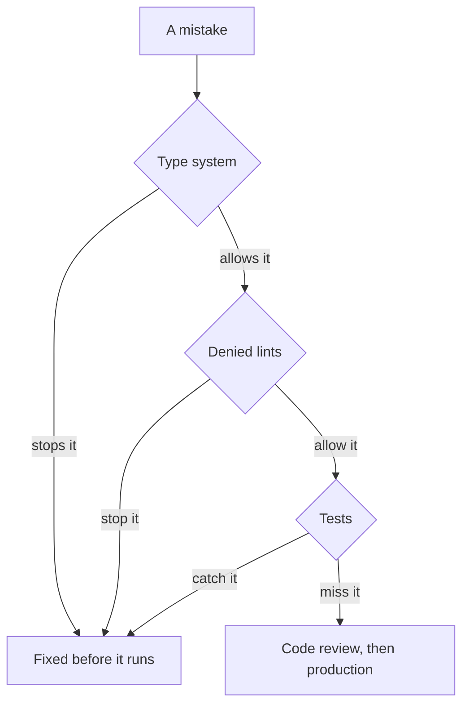

# Chapter 6: Guard rails

Code: [src/ch06_guard_rails.rs](../src/ch06_guard_rails.rs). Run it with `cargo test ch06`.

## The problem

Rust still gives you quick exits. `.unwrap()` turns a failure into a crash. `items[0]`
panics on an empty list. `_ =>` hides future enum variants. Tired people use them, and
so do coding agents, because they make the compiler stop complaining.

A style guide asks people to remember, and agents may never read it.

## The idea: rules that fail the build

Clippy is Rust's linter. It ships with hundreds of extra checks, most of them optional.
You can raise any check to an error in `Cargo.toml`:

```toml
[lints.clippy]
unwrap_used = "deny"
```

Now `.unwrap()` stops the build. An agent that writes it gets an error naming the lint,
and fixes it on the next attempt. You wrote the rule once, and nobody has to enforce it
in code review.



## The rails in this repo

Each rail has an example in `tests/lint_fail/` that trips it.

| Lint | The mistake it stops | Do this instead |
|---|---|---|
| `unwrap_used`, `expect_used` | A failure becomes a crash | Return a `Result` with `?` |
| `panic` | A crash for something a caller could cause | Return an `Err` |
| `indexing_slicing` | `items[0]` panics on an empty list | `items.first()` gives an `Option` |
| `as_conversions` | `300 as u8` becomes 44 with no warning | `u8::try_from(n)` gives a `Result` |
| `wildcard_enum_match_arm` | `_ =>` swallows new variants | List each variant |
| `let_underscore_must_use` | `let _ = save()` hides a failure | Handle the `Result` |
| `map_err_ignore` | `.map_err(\|_\| ...)` throws away why it failed | Keep the source, or convert with `From` |
| `let_underscore_future` | `let _ = save()` on a future never runs | `.await` it |
| `await_holding_lock` | A lock held during a slow wait | Release it before `.await` |
| `disallowed_methods` | Hidden inputs like the system clock | Pass them through `deps` |
| `allow_attributes` | Silent opt-outs | `#[expect(lint, reason = "...")]` |
| `allow_attributes_without_reason` | Exceptions nobody can judge | Add a `reason` |

## Exceptions need a reason

A rule with no escape hatch gets deleted. This repo lets you opt out with `#[expect]`:

```rust
#[expect(clippy::panic, reason = "a lesson about what a defect looks like")]
fn split_evenly(total: u32, people: u32) -> u32 { ... }
```

`#[expect]` beats `#[allow]` in two ways. It must state a reason, which your reviewer
can read. And it fails the build once the lint stops firing, so stale exceptions can't
pile up.

## Hidden inputs

`clippy.toml` bans `Instant::now`, `SystemTime::now`, `env::var` and `thread::sleep`. The
first three are hidden inputs. A function that reads the clock has a dependency its
signature hides, and your tests can't control it. Chapter 2's rule says to pass it in, and
this config enforces that. `thread::sleep` blocks a whole runtime thread, so async code
must use `tokio::time::sleep`.

## Test the rails themselves

Config rots. Someone edits a line, a tool upgrade renames a lint, and the rule stops
working with no warning.

So this chapter's test reads `Cargo.toml`, finds each denied lint, and runs Clippy on that
lint's example. The example must fail, and for the right reason. Add a lint with no example
and the test fails, which means each rule arrives with its proof.

## The cost: three silent drops get through

These all throw away a `Result`, and every rail here passes them:

```rust
_ = save();
save().ok();
drop(save());
```

`let _ = save()` trips a lint and its close relatives don't. Lesson 2 records that gap as
a test. If a future Clippy catches them, the test fails and you update the lesson. Until
then, code review has to find them.

## Lessons

| Lesson | The claim | Test |
|---|---|---|
| 1 | Each denied lint rejects its example | `lesson_1_every_denied_lint_rejects_its_example` |
| 2 | Three silent drops still get through | `lesson_2_three_silent_drops_still_get_through` |
| 3 | The guard rails skill installs these rails | `lesson_3_the_guard_rails_skill_installs_these_rails` |
| 4 | Each skill stands alone | `lesson_4_each_skill_stands_alone` |
| 4 | A skill can link by full URL only | `lesson_4_a_skill_can_link_by_full_url_only` |

Next: [chapter 7, the payment capstone](07-payment.md).
