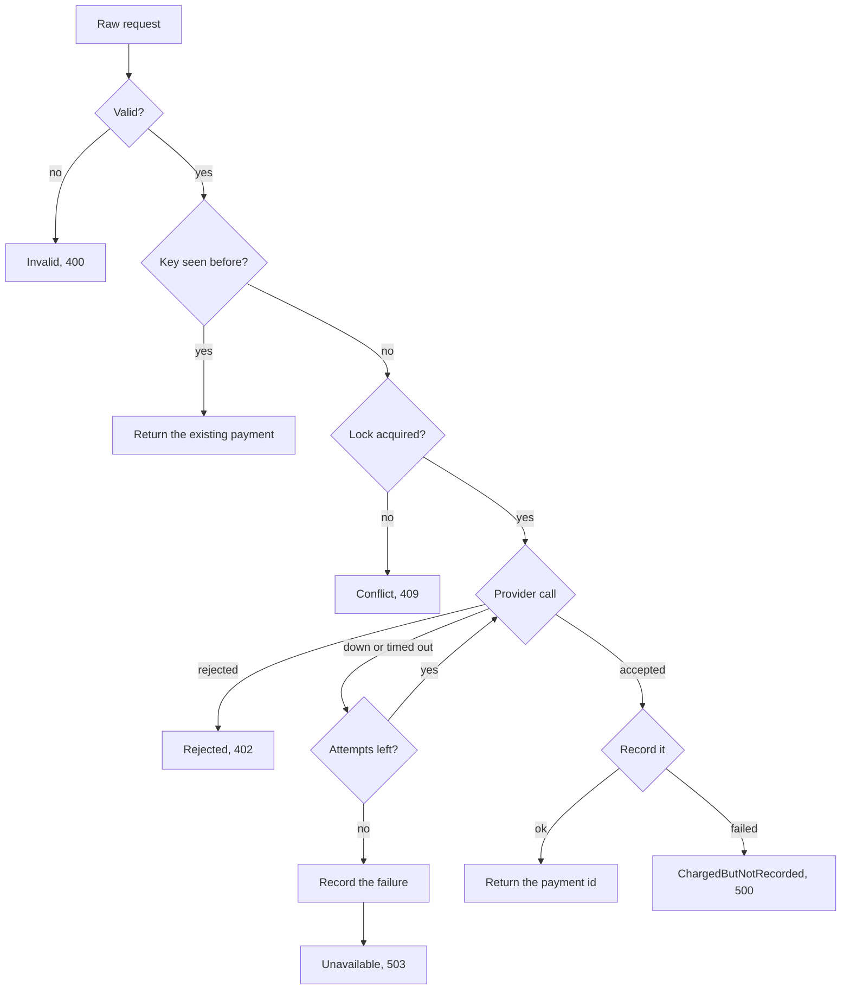
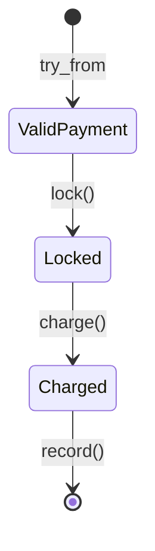
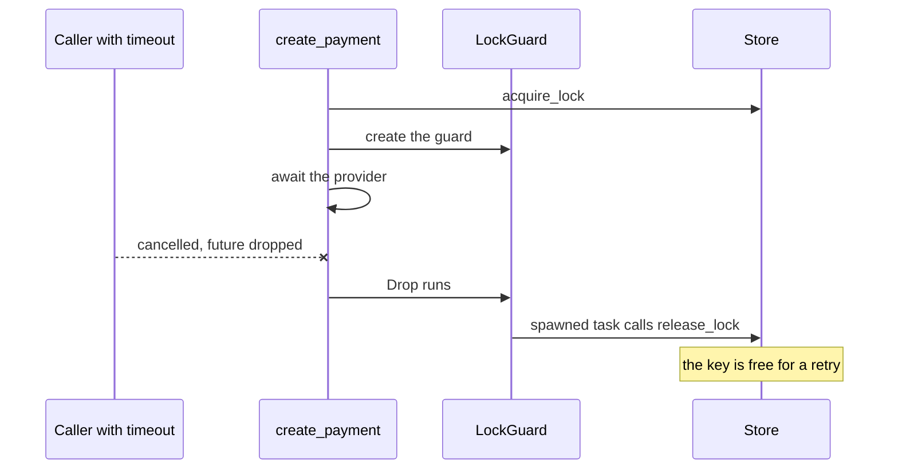
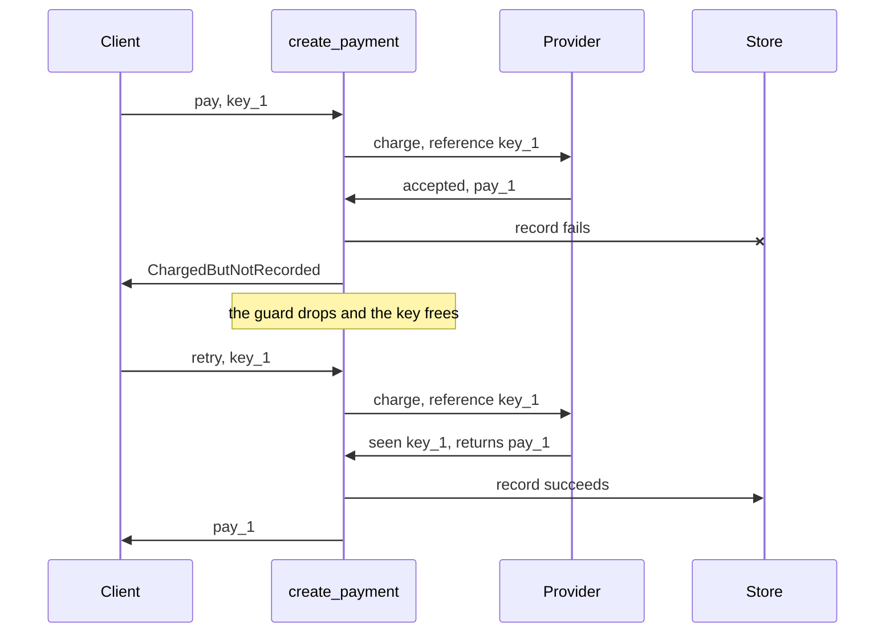

# Chapter 7: A payment you can trust

Code: [src/ch07_payment.rs](../src/ch07_payment.rs). Run it with `cargo test ch07`.

## The problem

You take payments. You can't lose a penny, and you can't charge anyone twice. Meanwhile
clients retry, providers time out, databases fall over, and requests get cancelled
halfway. This chapter puts all six earlier chapters into one workflow.

## The workflow



## Name each kind of failure

Each failure needs a different response, so each gets its own variant (chapter 1):

| Failure | Variant | Your response |
|---|---|---|
| The caller made a mistake | `Invalid` | Say which field is wrong |
| A retry raced the first request | `Conflict` | Ask them to try later |
| The provider said no | `Rejected` | Stop, and don't retry |
| The provider is down | `Unavailable` | Retry, then record the failure |
| Your database is down | `StoreDown` | Page someone |
| Money moved with no record | `ChargedButNotRecorded` | Page someone now, with the payment id |
| Your code has a bug | a panic | Fix the code |

`ChargedButNotRecorded` is the one to study. It keeps the provider's payment id inside the
error, so a person can find the money.

## Stages as types

The workflow uses typestate (chapter 4). Each step consumes the last:



The provider call lives on `Locked`, so charging without the lock can't compile. The types
are private to the `payment` module, so outside code can call `create_payment` and nothing
else.

The whole workflow reads as a straight line. Each `?` marks a way off it:

```rust
let payment = ValidPayment::try_from(request)?;
if let Some(existing) = deps.store.find_by_key(&payment.key).await? {
    return Ok(existing);
}
let locked = payment.lock(deps).await?;
let charged = locked.charge(deps).await?;
charged.record(deps).await
```

## Two layers stop a double charge

Clients retry, so you need protection at two levels:

| Layer | Stops | How |
|---|---|---|
| Idempotency key | A repeat after the first one finished | `find_by_key` returns the stored payment |
| Lock | A repeat while the first is running | `acquire_lock` turns the second one away |

Inside `charge`, stable retry identity (chapter 5) covers a third case. The provider
receives the same reference on each attempt, so a timed-out attempt that took the money
won't take it again.

## A lock that survives cancellation

A lock you never release blocks that key forever. Chapter 5 said each `.await` can end your
function, so a `release_lock().await` at the bottom can get skipped. Chapter 3 said `Drop`
always runs but can't wait. Put those together:

```rust
impl Drop for LockGuard {
    fn drop(&mut self) {
        let store = self.store.clone();
        let key = std::mem::take(&mut self.key);
        let Ok(runtime) = Handle::try_current() else { return };
        runtime.spawn(async move {
            // release_lock runs here, as its own task
        });
    }
}
```



`Drop` runs on each way out, and the spawned task keeps going after the request has gone.
This is the Rust-shaped answer to cleanup under cancellation. Use it for anything that must
happen.

Two limits remain. A process crash skips `Drop`, so a real lock also needs an expiry. And the
release lands a moment after the request ends, so an instant retry can see `Conflict`, which
is safe.

## The gap the lock doesn't cover

Follow this failure through:



The lock has gone, and `find_by_key` finds nothing, so the retry reaches the provider again.
The stable reference protects you here, and the protection depends on the provider honouring
it. If your provider doesn't, keep the key held until a person has reconciled the payment.

## Stories

The tests here double as a report. Each one uses `Story` from the `executable-stories` crate
to label its steps with Given, When and Then, so someone who doesn't read Rust can follow it:

```rust
let mut story = Story::new("A cancelled request can be tried again");
story.given("a provider that hangs, then recovers");
```

The README shows how to generate the report.

## Scenarios

| Scenario | Test |
|---|---|
| A valid payment | `a_valid_payment_is_charged_once_and_recorded` |
| A bad request | `a_bad_request_never_reaches_the_provider` |
| A repeated request | `a_repeated_request_returns_the_first_payment` |
| A racing request | `a_racing_request_is_turned_away` |
| A rejected card | `a_rejected_card_is_not_retried` |
| A brief outage | `a_brief_outage_is_retried_without_double_charging` |
| A long outage | `a_long_outage_is_recorded_as_a_failure` |
| A lost record | `money_taken_without_a_record_is_never_lost_silently` |
| A finished payment | `a_finished_payment_frees_its_key` |
| A failed payment | `a_failed_payment_can_be_tried_again` |
| A cancelled request | `a_cancelled_request_can_be_tried_again` |
| A retry after a lost record | `a_retry_after_a_lost_record_reuses_the_reference` |

## Your next step

The chapter's exercise starts where the lock's limits end. Simulate a crash, prove the lock
expires, then work out what stops a double charge when a slow charge outlives its lock. You'll
need all seven chapters for that one.

Run it with `cargo test ch07 -- --ignored`, and see the
[story report steps](../README.md#the-story-report) to read your results as a report.
